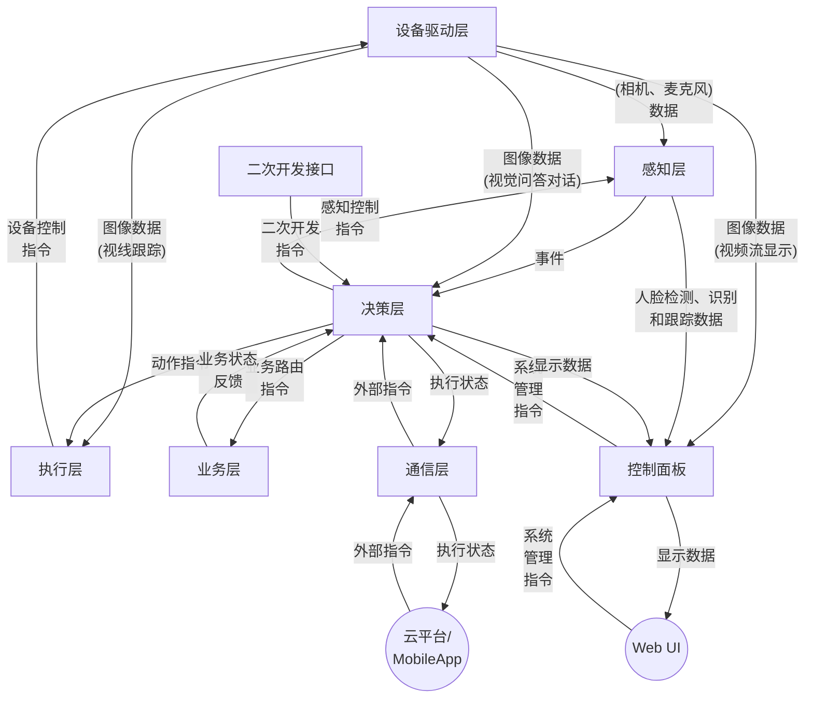
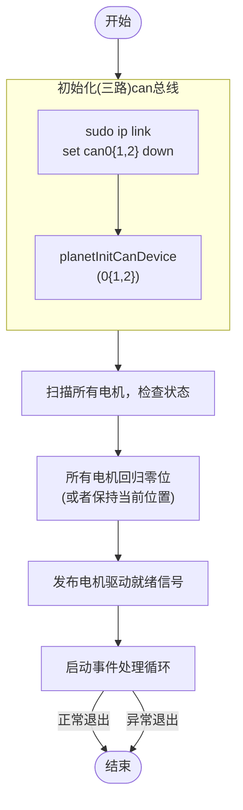
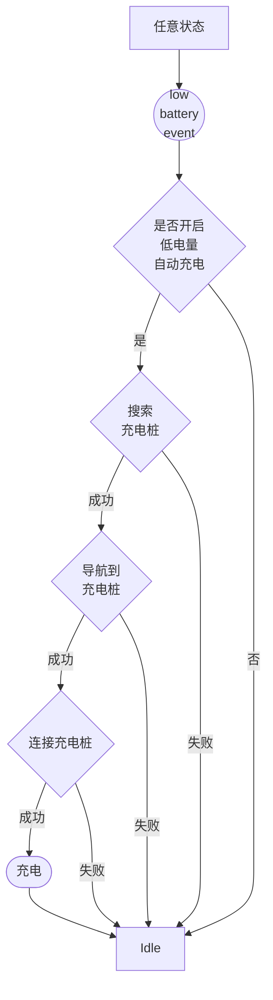
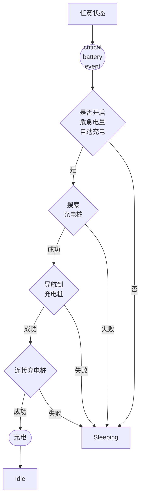
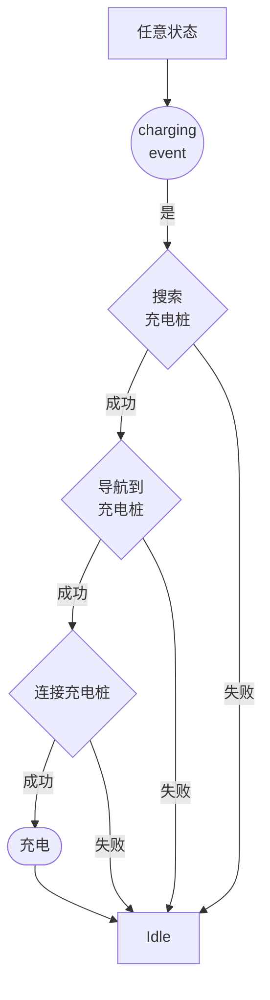
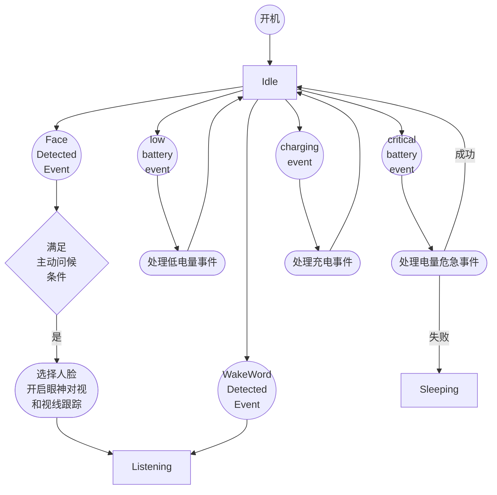
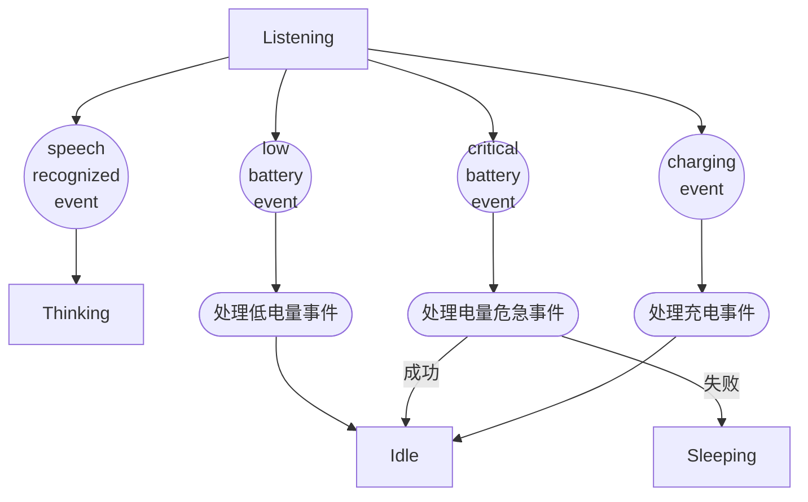
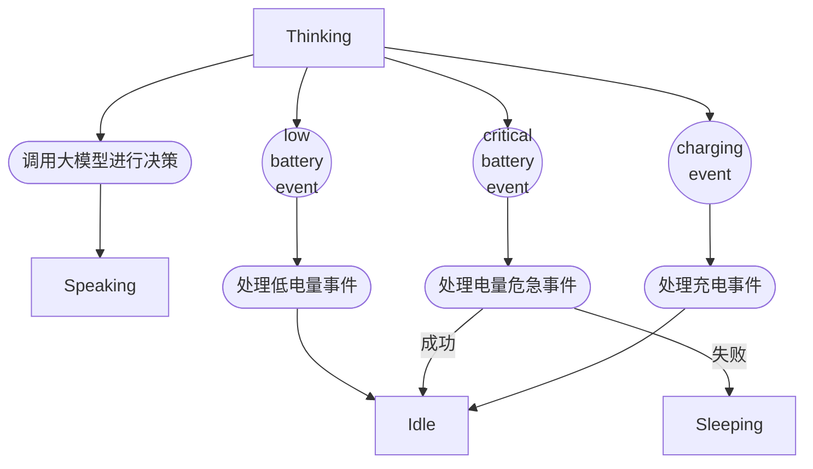
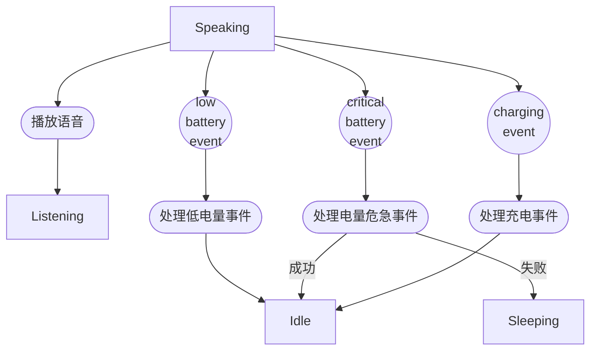
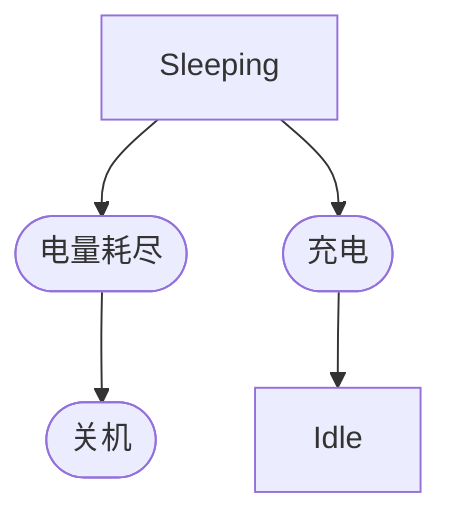

# YmRobot项目架构设计文档

## 1. 架构总览

本项目的总体架构按以下七层架构进行设计：设备驱动层、感知层、决策层、执行层、通信层、业务层和控制面板，同时考虑提供二次开发接口。

各个模块的层级关系和数据流转如下图：



### 设备驱动层(drivers)
- usb_cam: 相机驱动程序
- can_motor_driver: CAN-电机驱动程序，目前用于双臂和颈部 12 个电机的控制
- serial_motor_driver: 串口-电机驱动程序，目前用于头部(22/26/34自由度)和双手(12自由度)的电机控制
- chassis_controller: 底盘控制程序
- battery_monitoring(电池电量检测服务): 
  <br>battery_monitoring 暂时没有合适的模块放置，单独给一个系统监控层层(monitoring)又显得浪费(目前只有这一个监控服务)，所以先放到设备层。如果以后有更多的监控需求，应该增加一个单独的系统监控层。

### 感知层(perception)
- 语音唤醒词检测服务(wakeup_service)
- 自动语音识别服务(speech_recognition_service)
- 人脸检测服务(face_detection_service)
- 面部/动作捕捉(face/motion_capture)

### 决策层(core)
决策层的职责是作为机器人的大脑完成核心决策(通过大模型进行决策)、状态机维护以及任务调度。
- 状态机(StateMachine)
  - 状态(State)
  - 事件(Event)
  - 状态转移规则(State Transition rules)
- 大模型决策程序(大脑，brain): 决策层主程序，机器人的大脑
  - 人脸数据分析 + 主动问候检测
  - LLM 调用框架
  - tools/mcp/skills
  - 对话生成(dialog_service)
  - 意图识别(intent_detecting)
  - 任务调度(TaskScheduling)
  - 场景(业务)路由(ScenarioRouting)
  - Agent: 接入第三方 Agent

### 执行层(action)
- 集成模块(integrations): 工具
  - AudioPlayer: 
  - AnimationPlayer: 表情/身体动画播放器
  - DancePlayer(舞蹈播放器):
  - TTS
  - Audio2Face
  - 身体动作生成
- 语音播放服务(speech_playing_service)
- 视线追踪服务(gaze_tracking_service)
- 动画库
  - 表情动画库
  - 身体动画库
  - 剧本 

### 通信层(communication)
- 云平台通信(MQTT Client)
- 手机App通信(WebSocket Service)

### 业务层(Scenarios): 需要良好的扩展性，可以轻松的添加新的业务代码
- 访客接待
- 自动巡检
- 展厅导览
- 景区导览

### 控制面板(dashboard)
- 配置管理(config managing)
- 日志查看(log viewing)
- 相机视频流、视觉检测结果查看(video display)
- 功能模块开启/关闭以及启动设置(feature managing)

### 二次开发接口(API/SDK)
提供二次开发的外部调用接口。

## 2. 设备驱动层

设备驱动层包含以下 5 个 ROS 节点：
- usb_cam: 相机驱动程序
- can_motor_driver: CAN电机驱动程序
- serial_motor_driver: 串口电机驱动程序
- chassis_controller: 底盘控制程序
- battery_monitoring: 电池电量检测服务

### 2.1 相机驱动程序

**模块名称**: `usb_cam`（基于 ros-drivers/usb_cam 定制）

**功能定位**: USB 相机驱动节点，负责图像数据采集和发布

**参数配置**:
- 配置文件路径: 
  - `~/.ymrobot/usb_cam/config/camera_params.yaml`
- 默认参数(适用于 lubancat RK3588):
  ```yaml
  /**:
    ros__parameters:
      video_device: "/dev/video0"
      framerate: 30.0
      io_method: "mmap"
      frame_id: "head_camera"
      pixel_format: "mjpeg2rgb"
      av_device_format: "YUV422P"
      image_width: 640
      image_height: 480
      camera_name: "head_camera"
      camera_info_url: ""
      brightness: 15
      contrast: 14
      saturation: 65
      hue: 0
      gamma: 155
      sharpness: 4
      gain: -1
      white_balance: -1
      exposure: -1
      focus: -1
  ```
  - 参数说明：
  1. 为什么分辨率使用 `640*480`？
  - 在云小慕上出现过相机驱动缓冲区(一块在内核空间开辟的缓存)溢出(也就是数据消费速度赶不上数据生产速度)的问题，把分辨率改到了 `640*480`，才好的。
  - 北京展会前，洛神上实跑测试，USB 相机的数据传输带宽只有 12M，使用 opencv 默认参数(1080P)打开，`1920*1080*3B*30/s=186.624MB/s`，这个数据量已经远超了 usb 相机 12M/s 的数据传输带宽了。
  - 目前，大多数模型使用 `640*480` 分辨率已经足够了。
  - 如果实在觉得 `640*480` 分辨率太低，可以修改为 `1280*720` (720P)。
  2. 像素格式
  - `av_device_format: YUV422P`：
    <br>FFmpeg 解码 MJPEG 时的内部中间格式，不影响最终输出。
  - `pixel_format: mjpeg2rgb`：
    <br>决定最终输出格式，告诉 usb_cam 把 MJPEG 解码成 RGB。
  - 数据传输链路:
    MJPEG(相机内部数据)-->(USB 传输、FFmpeg解码)-->YUV422P-->(FFmpeg解码)-->RGB8-->ros2 topic.

**发布话题**:
- `/camera_info` (sensor_msgs/CameraInfo): 相机内参信息
- `/image_raw` (sensor_msgs/Image): 原始图像流，主要数据通道
- `/image_raw/compressed` (sensor_msgs/CompressedImage): MJPEG 压缩图像（仅在 pixel_format=mjpeg 时发布）
- `/hardware/error` (ymrobot_msgs/HardwareError): 硬件错误上报（transient_local QoS）
- 话题说明:
  - 当像素格式 pixel_format=mjpeg2rgb (默认的配置)时，只发布 `/camera_info` 和 `/image_raw`
  - `/image_raw/compressed` 仅在 pixel_format=mjpeg（不解码）时发布
  - `/hardware/error` 用于硬件异常上报
  - 实际运行时通常只有 **3个活跃话题**（/image_raw, /camera_info, /hardware/error）
  - 订阅者:
    |节点|订阅话题|模块|功能|
    | :---: | :---: | :---: | :---: |
    |人脸检测服务|/image_raw<br>(sensor_msgs/Image)|感知层|人脸检测、特征提取、表情识别、姿态估计等|
    |面部/动作捕捉|/image_raw<br>(sensor_msgs/Image)|感知层|面捕、动捕|
    |大模型决策程序|/image_raw<br>(sensor_msgs/Image)|决策层|视觉问答、多模态对话生成|
    |视线追踪|/image_raw<br>(sensor_msgs/Image)|执行层|人脸追踪、视线跟随、头部运动控制|
    |相机视频流、视觉检测结果查看|/image_raw<br>(sensor_msgs/Image)|控制面板|相机视频流、视觉检测结果实时查看|

### 2.2 CAN-电机驱动程序

这个程序需要设计机制，保证同时只能有一个程序通过 can 总线发送电机控制指令。一个方案是: 不是每次启动先 set down 所以 can 总线，然后再由 Planet SDK up，而是检测到有 can 总线 up, 则说明已有程序(既有可能是另一个电机控制进程)在占用 can 总线，报错并停止启动即可。

**模块名称**: `can_motor_driver`

**功能定位**: **双臂**和**颈部**电机的底层驱动，纯粹的设备层抽象，不包含业务逻辑。
- CAN(Controller Area Network) 总线通信管理
- 电机控制: 发送电机控制(位置/速度/力矩)指令
- 反馈数据读取
- 故障检测与上报
- 硬件限位保护(读取并强制执行电机物理极限)
- ❌ **不做**关节映射（joint_name → motor_id）
- ❌ **不做**运动插值（由执行层负责）
- ❌ **不做**软限位检查（业务规则由执行层负责）

**参数配置**:
- 配置文件路径: 
  - `~/.ymrobot/can_motor/config/motor_config.yaml`
- 默认参数配置:
  ```yaml
  # 纯设备层配置
  can_buses:
    - can_id: 0
      motors:
        - id: 41
          type: "eu_motor"
          hardware_limit: [-180, 180]
    
        - id: 42
          type: "eu_motor"
          hardware_limit: [-180, 180]
    
        - id: 43
          type: "eu_motor"
          hardware_limit: [-180, 180]
    
        - id: 44
          type: "eu_motor"
          hardware_limit: [-180, 180]
    
        - id: 45
          type: "eu_motor"
          hardware_limit: [-180, 180]
    # 颈部电机
    - can_id: 1
      motors:
        - id: 21
          type: "eu_motor"
          hardware_limit: [-180, 180]
    
        - id: 22
          type: "eu_motor"
          hardware_limit: [-180, 180]
    - can_id: 2
      motors:
        - id: 31
          type: "eu_motor"
          hardware_limit: [-180, 180]
    
        - id: 32
          type: "eu_motor"
          hardware_limit: [-180, 180]
    
        - id: 33
          type: "eu_motor"
          hardware_limit: [-180, 180]
    
        - id: 34
          type: "eu_motor"
          hardware_limit: [-180, 180]
    
        - id: 35
          type: "eu_motor"
          hardware_limit: [-180, 180]
  
  baudrate: 1000000
  timeout_ms: 60
  retry_count: 2
    
  control:
    # 应用场景 | 控制频率 | 反馈频率 | 说明
    # 慢速展示动作 | 50Hz | 25Hz | 低功耗 |
    # 正常运动 | 100Hz | 50Hz | 平衡 |
    # 快速响应（视线追踪） | 200Hz | 100Hz | 高性能配置(CPU占用高)
    # 控制更新频率 100Hz (建议在 60~100Hz)
    update_rate: 100
     # 反馈读取频率 25Hz
    feedback_rate: 50
    enable_watchdog: true
    watchdog_timeout_ms: 100
    # 硬限位行为策略: clamp=限制到边界, reject=拒绝执行
    hard_limit_action: "clamp"
  ```

**CAN 总线初始化**

1. CAN 总线初始化: *`sudo ip link set can* down`* (需要 sudo 权限)
2. Planet SDK（socketcan）会自行执行 *`ip link set canX up type can bitrate 1000000`*
> PS 这里来自原 src/h_digital2robot 源码逻辑，个人观点认为这里不是很合理，会导致同时起多个电机程序成为可能，从而导致意外的情况。实际上，个人认同 Planet SDK CAN 总线忙(被占用)则报错不启动的做法，宁可不启动，防止意外。

**硬限位检查**:

- 为什么需要硬限位检查？
1. 硬件保护职责：设备驱动应该保护硬件不被误用
2. 防御性编程：不依赖上层代码的正确性
3. 最后安全防线：即使上层数据有bug，也不会损坏硬件
4. 行业标准：工业机器人驱动都有硬限位保护

- 硬限位检查伪代码(c++)实现:
```cpp
// 检查是否超出电机物理极限
if (target_pos < motor.hw_limit_min || target_pos > motor.hw_limit_max) {
    // 记录错误
    RCLCPP_ERROR("Motor %d exceeds hardware limit", motor_id);
    
    // 选项1：限制到硬件边界（安全）
    target_pos = std::clamp(target_pos, hw_limit_min, hw_limit_max);
    
    // 选项2：拒绝执行（更严格）
    // return;  
    
    // 发布错误消息
    publishError(motor_id, ERROR_HARDWARE_LIMIT_EXCEEDED);
}
```

**三种电机控制模式**:

1. **位置模式(mode=0)**
- 控制目标：电机转到指定角度
- 使用字段：motor_ids + positions
- 应用场景：关节定位（抬手、挥手、指向）
- 示例：左肘弯曲到90度

2. **速度模式(mode=1)**
- 控制目标：电机以指定速度持续旋转
- 使用字段：motor_ids + velocities
- 应用场景：连续扫描、跟踪运动
- 注意：关节有限位，不适合无限旋转

3. **力矩模式(mode=2)**
- 控制目标：电机输出指定大小的力
- 使用字段：motor_ids + torques
- 应用场景：柔顺抓取、人机协作、重力补偿
- 特点：位置由外力平衡决定

**订阅话题**:

电机控制指令(`/motor/command`)
```yaml
/can_motor/command (motor_msgs/CanMotorCommand): # 电机指令
  motor_ids: int32[]      # 电机ID列表
  positions: float64[]    # 目标位置（度）
  velocities: float64[]   # 可选：目标速度（度/秒）
  torques: float64[]      # 可选：目标力矩（N·m）
  mode: uint8             # 0=位置模式, 1=速度模式, 2=力矩模式
```

**发布话题**:

1. 电机驱动就绪信号(`/motor/ready`)
<br>在 CAN 总线初始化完成、所有电机状态检查完成（或回零）后发布，通知上层程序可以启动或者初始化了。此消息用于解决上层程序必须等待若干秒后再启动的问题。
```yaml
/can_motor/ready (std_msgs/Bool):
  data: true              # 驱动就绪，上层可以开始执行初始化
  QoS: transient_local    # 保证上层程序即使晚启动也能收到消息
```

2. 电机状态(`/motor/state`)
```yaml
/can_motor/state (motor_msgs/CanMotorState):
  motor_ids: int32[]          # 电机ID
  positions: float64[]        # 当前位置（度）
  velocities: float64[]       # 当前速度（度/秒）
  torques: float64[]          # 当前力矩
  temperatures: float64[]     # 温度
  errors: uint8[]             # 错误码
```

3. 错误消息(`/motor/error`)
```yaml
/can_motor/error (motor_msgs/CanMotorError):
  motor_id: int32
  error_code: uint8
  error_msg: string
  timestamp: time
```

**服务接口**:

- 使能/失能所有电机
```yaml
/can_motor/enable (std_srvs/SetBool):
```

- 复位错误状态
```yaml
/can_motor/reset (std_srvs/Trigger):
```

- 电机零位校准
```yaml  
/can_motor/calibrate (motor_msgs/Calibrate):
```

**启动流程**



**实现**
<br>新设计将电机模块严格限定为**设备层驱动**，只负责硬件抽象和 CAN 总线通信，所有业务逻辑（关节映射、插值、限位）上移到执行层，符合分层架构原则。
1. 提取纯驱动代码
- 从 `ymbot_devices_driver` 提取CAN通信部分
- 移除关节映射逻辑
- 实现新的ROS2接口
2. 将joint_mapper移到执行层
- 重构为 `motion_controller` 或集成到现有执行模块
- 关节映射、插值、限位都在执行层完成
3. 统一配置
- 设备层：`motor_config.yaml`（电机ID、CAN配置）
- 执行层：`joint_mapping.yaml`（关节名→电机ID映射）
4. 参考实现（伪代码）
```cpp
// can_motor_driver.cpp - 设备层驱动
class MotorDriver : public rclcpp::Node {
private:
    // 订阅电机指令
    rclcpp::Subscription<motor_msgs::msg::MotorCommand>::SharedPtr cmd_sub_;
    
    // 发布电机状态
    rclcpp::Publisher<motor_msgs::msg::MotorState>::SharedPtr state_pub_;
    
    // CAN设备管理
    std::map<int, CANDevice> can_devices_;  // CAN索引 → 设备
    std::map<int, MotorInfo> motors_;       // 电机ID → 电机信息
    
    void commandCallback(const motor_msgs::msg::MotorCommand::SharedPtr msg) {
        // 简单：直接发送到对应电机
        for (size_t i = 0; i < msg->motor_ids.size(); ++i) {
            int motor_id = msg->motor_ids[i];
            double position = msg->positions[i];
            
            // 查找电机配置
            auto& motor = motors_[motor_id];
            
            // 发送CAN指令
            sendPositionCommand(motor.can_bus, motor_id, position);
        }
    }
    
    void updateLoop() {
        // 读取所有电机反馈
        motor_msgs::msg::MotorState state;
        for (auto& [id, motor] : motors_) {
            auto feedback = readMotorFeedback(motor.can_bus, id);
            state.motor_ids.push_back(id);
            state.positions.push_back(feedback.position);
            state.velocities.push_back(feedback.velocity);
        }
        state_pub_->publish(state);
    }
};
```

### 2.3 串口-电机驱动程序

**模块名称**: `serial_motor_driver`

**功能定位**: 统一管理串口电机控制指令，防止串口资源竞争。上层所有需要通过串口发送的指令必须经过这一层转发。

**防串口竞争机制**:
- 使用串口文件锁 (`/var/lock/lockttyusb0`)
- 内部使用消息队列串行化所有指令
- 支持指令优先级（紧急表情 > 普通动作）

**实现方案**:
1. 迁移 timestamp_blendshape_servo 的串口通信层
2. 抽象舵机协议接口，支持多种舵机
3. 实现指令队列和优先级调度
4. 添加舵机状态查询功能（如果协议支持）

### 2.4 底盘控制程序

**模块名称**: `chassis_controller`

**功能定位**: 底盘运动控制，支持速度控制和里程计反馈，对接 ROS2 导航栈。

**实现方案**: 迁移 h_control/chassis 中相关实现。

### 2.5 电池电量监控服务

**模块名称**: `battery_monitoring`

**功能定位**: 监控电池电量、电压、充电状态，发布低电量和危急电量事件。

**发布话题**:
```yaml
/battery/state (battery_msgs/BatteryState):
  percentage: float        # 电量百分比(%)
  voltage: float           # 电压(V)
  current: float           # 电流(A)
  temperature: float       # 温度(°C)
  charging: bool           # 是否在充电
  time_to_empty: int       # 预计续航时间(秒)

/battery/event (battery_msgs/BatteryEvent):
  event_type: str          # "low", "critical", "charging", "full"
  timestamp: time
```

**事件触发逻辑**:
```python
def check_battery_state():
    if percentage < critical_threshold and not charging:
        publish_event("critical")
    elif percentage < low_threshold and not charging:
        publish_event("low")
    elif charging and percentage > full_threshold:
        publish_event("full")
```

**实现方案**:
迁移 h_control/battery 中的电池通信协议和监控逻辑。

## 3. 感知层

### 3.1 语音唤醒词检测服务

**模块名称**: `wakeup_service`

**功能定位**: 
<br>运行持续检测自定义的唤醒词，并发布 WakeWordDetectedEvent 事件。
- 空闲状态: 触发唤醒动作，进入对话模式。
- 对话状态: 可用于打断当前对话(继承自原 aud_conver)。

**实现**: 迁移 `src/aud_conver/aud_conver/client_module`并进改造行优化

**发布话题**

- /wake_word_detected_event: 检测到唤醒词事件
```yaml
/wake_word_detected_event:
  timestamp: time
  wake_word: str           # 识别到的唤醒词
  confidence: float        # 置信度 0-1
  audio_snippet: bytes[]   # 可选：唤醒词音频片段（用于调试）
```

### 3.2 自动语音识别服务

**模块名称**: `speech_recognition_service`

**功能定位**: 进入对话模式时运行，自动识别用户的语音内容，后续通过大模型生成响应(注意: 响应生成不包含在语音识别服务中)。

**发布话题**

- /speech_recognized_event: 检测到唤醒词事件
```yaml
/speech_recognized_event:
  content: str
  timestamp: float
```

**实现方案**
1. 声音拾取: sounddevice 输入流
2. VAD: 需要支持在线/离线VAD
3. ASR: 在线/离线ASR,可根据需要和效果自由切换
4. 只在识别到最终完整的结果时发布 /speech_recognized_event

**后续优化:**
- 声纹识别
- 多人人声分离
- 声源（方向）定位
- 联合人脸模块锁定说话人

### 3.3 人脸检测服务

**模块名称**: `face_detection_service`

**功能定位**: 实时检测视野内人脸信息，后续用于主动问候感知、视线跟踪、访客接待等服务

**订阅话题**:
- /image_raw

**发布话题**:
- /perception/face_detected_event
```yaml
face_detected_event:
  timestamp: time
  faces:
    - face_id: uuid
      boundding_box: [x, y, w, h]
      confidence: float
      landmarks: [float]
      # 512 或者 1024 维 float 数据量太大，故发布的数据不携带特征向量，而使用 face_id 作为唯一键
      # embedding: [float]
      quality: float  # 人脸质量评分 0-1
      face_pose: [roll, pitch, yaw]
      eye_state: float
      interaction: Normal/...
      emotion: Neutral/...
      gender: Female/Male
      age_bracket: int
      distance: float
      face_info: {}
```

**人脸检测项目**
- 人脸检测(Face Detection)
- 面部特征点(Face Landmarks)
- 面部特征向量(Face Embedding)
- 人脸（头部）姿态估计(Face Pose Estimation)
- 眼睛状态预测(Eyes State Prediction)
  - 睁眼
  - 闭眼
  - 半睁半闭
- 面部交互动作(Face Interactions Action Detection)
  - Normal: 正常状态，无特殊动作
  - HeadShake: 摇头动作，头部左右移动
  - JawOpen: 张嘴动作，张开嘴巴
  - HeadRaise: 抬头动作，头部向上抬起
  - Blink: 眨眼动作，闭眼再睁眼”
- 面部情绪(Face Emotion)
  - 0: Neutral
  - 1: Happy
  - 2: Sad
  - 3: Surprise
  - 4: Fear
  - 5: Disgust
  - 6: Anger
- 性别(Gender)
  - 0: 女性 (Female)
  - 1: 男性 (Male)
- 年龄段(Age Bracket)
  - 0: 0-2岁
  - 1: 3-9岁
  - 2: 10-19岁
  - 3: 20-29岁
  - 4: 30-39岁
  - 5: 40-49岁
  - 6: 50-59岁
  - 7: 60-69岁
  - 8: 70岁以上
- 人脸距离(深度)估计

### 3.4 面部/动作捕捉(face/motion_capture)

**模块名称**: `motion_capture`

**功能定位**: 捕捉用户的面部表情和身体动作，用于动画录制和回放。

**参数配置**:
```yaml
motion_capture:
  capture_rate: 30  # 捕捉帧率(FPS)
  
  capture_targets:
    face: true       # 捕捉面部表情
    body: true       # 捕捉身体动作
    hands: false     # 捕捉手部动作（可选）
  
  output:
    format: "json"   # json, pkl, bvh
    directory: "~/.ymrobot/motion_capture/recordings"
    auto_name: true  # 自动生成文件名（时间戳）
```

**订阅话题**:
```yaml
/image_raw (sensor_msgs/Image):  # 用于视觉捕捉
/motion_capture/start (std_msgs/String):  # 开始捕捉
/motion_capture/stop (std_msgs/Empty):    # 停止捕捉
```

**发布话题**:
```yaml
/motion_capture/status (motion_msgs/CaptureStatus):
  is_capturing: bool
  frame_count: int
  duration: float
  output_file: str

/motion_capture/preview (motion_msgs/CaptureFrame):
  timestamp: float
  face_blendshapes: float64[]  # 52 维 ARKit blendshapes
  body_joints: float64[]       # 关节位置/角度
```

**服务接口**:
```yaml
/motion_capture/start (std_srvs/Trigger):
  # 开始捕捉，返回录制文件路径

/motion_capture/stop (std_srvs/Trigger):
  # 停止捕捉，保存文件

/motion_capture/export (motion_msgs/Export):
  # 导出为指定格式
```

**实现方案**:
1. 使用 MediaPipe 或 OpenPose 进行人体姿态估计
2. 使用 ARKit / 3DDFA 进行面部捕捉
3. 数据格式参考业界标准（BVH, FBX 等）

## 4. 决策层

职责: 核心决策、状态机维护与任务调度。

### 4.1 状态机(StateMachine)

#### 4.1.1 状态(State)

#####  *Idle*
空闲状态，机器人开机后默认进入的状态。
进入此状态会开启语音唤醒词检测服务、人脸检测服务、主动问候感知服务和电池电量监控服务，并且伴随开启**面部灵动微表情**和**身体灵动微动作**，以展现灵动性。

空闲状态需要进行主动问候决策，决策逻辑详见 4.2.1。

灵动性展现方式: 
1. 面部灵动微表情
2. 身体灵动微动作
3. 缓慢的转动脖子，扫视周围环境
4. 随机低头、眨眼
5. 检测到人脸停留，进行眼神对视和跟踪发起主动问候(详见 4.2.1 主动问候逻辑)

#####  *Listening*
聆听状态，空闲状态发起主动问候之后或者收到 *WakeWordDetectedEvent* 被唤醒后进入此状态。进入聆听状态表示对话模式已开启，正在聆听用户语音；同时开启自动语音识别服务，实时识别用户的语音内容，与用户聊天。

在聆听状态，如果一段时间没有收到 *SpeechRecognizedEvent* (用户的语音)则回到空闲状态。这个时间的长短与进入 *Listening* 状态的触发方式相关，如果是主动问候触发，则等待时间是等待主动问候回应的最大时间(比如 8s)，如果是语音唤醒或者正常一轮对话结束等待用户讲话，则是等待用户语音的最大时间(比如 180s)。

灵动性展现方式: 
1. 锁定正在讲话的用户，眼神对视，视线跟随
2. 随机间隔时间眨眼，或者眼神轻微漂移到别的地方，然后再收回来，避免一直盯着用户。
3. 聆听微表情，表现出正在认证倾听用户的讲话

#####  *Thinking*
思考状态，聆听状态收到 *SpeechRecognizedEvent* (识别到用户的语音内容)进入此状态。在思考状态下，机器人大脑(LLM)识别用户的意图，思考如何回应用户的语音内容。

灵动性展现方式: 
<*To be completed.*>

#####  *Speaking*
讲话状态。

灵动性展现方式: 
1. 锁定正在对话的用户，眼神对视，视线跟随
2. 语音播放、表情、动作三者同步
3. 表情(嘴型)要匹配声音
4. 动作需要匹配语义

#####  *Dancing*
正在跳舞的状态。

#####  *Moving*
正在行走/移动的状态。

#### *Sleeping*
电量危急(Critical Battery)状态的低功耗状态，关闭大部分功能，只保留眨眼、脖子缓慢转动。

灵动性展现方式: 
1. 关闭大部分功能，进入低功耗模式
2. 只保留缓慢的脖子转动和眨眼动作，告诉用户机器人还“活着”(未关机)

#### 4.1.2 充电状态(ChargingState)

#### 4.1.3 事件(Event)

##### FaceDetectedEvent
定义:
```python
from pydantic import BaseModel


class EulerAngle(BaseModel):
    roll: float
    pitch: float
    yaw: float


class Face(BaseModel):
    face_id: uuid
    boundding_box: tuple[int, int, int, int] # [x, y, w, h]
    confidence: float
    landmarks: list[float]
    quality: float  # 人脸质量评分 0-1
    face_pose: EulerAngle
    eye_state: float
    interaction: FaceAction
    emotion: FaceEmotion
    gender: Gender # Female/Male
    age_bracket: AgeBracket
    distance: float
    face_info: dict {
        "name": ...,
        "other_info": ...,
    }


class FaceDetectedEvent(BaseModel):
    timestamp: float
    faces: list[Face]
```
发布: 人脸检测程序检测到人脸时发布。

##### WakeWordDetectedEvent
定义:
```python
class WakeWordDetectedEvent(pydantic.BaseModel):
    timestamp: float
    wake_word: str
    confidence: float
```
发布: wakeup_service 检测到唤醒词发布。

##### SpeechRecognizedEvent
定义:
```python
class SpeechRecognizedEvent(pydantic.BaseModel):
    timestamp: float
    content: str
    confidence: float | None = None
```
发布: 自动语音识别服务识别到完整的内容(句子)时发布。

##### LowBatteryEvent
定义:
```python
class LowBatteryEvent(pydantic.BaseModel):
    timestamp: float
    battery: int
```
发布: 电量检查服务检测到电量 5% <= battery < 15% 发布。

处理:
```python
def handle_low_battery_event(self, event: LowBatteryEvent):
    """不切换状态"""
    # 结束正在运行的任务: 
    self.stop_running_tasks()
    # 还是等待任务结束: self.wait_running_tasks() ?
    
    self.battery = event.battery
    self.battery_state = BatteryState.LowBattery
    self.alarm_low_battery()
    
    if not low_battery_auto_charging_enabled():
        self.charging_state = ChargingState.LowBatteryAutoChargingDisabled
        self.alarm_low_battery_auto_charging_disabled()
        return

    if not acquire_charging_dock():
        self.charging_state = ChargingState.ChargingDockUnavailable
        self.alarm_charging_dock_unavailable()
        return

    if not navigate_to_charging_dock():
        self.charging_state = ChargingState.NavigationToChargingDockFailed
        self.alarm_navigate_to_charging_dock_failed()
        return

    if not connect_to_charging_dock():
        self.charging_state = ChargingState.ConnectionToChargingDockFailed
        self.alarm_connect_to_charging_dock_failed()
        return

    self.battery_state = BatteryState.Charging

    # 选择策略是结束正在运行的任务: 
    self.transition_to(State.Idle)
    # 选择策略是等待任务结束: 不切换状态
    return
```



##### CriticalBatteryEvent
定义:
```python
class CriticalBatteryEvent(pydantic.BaseModel):
    timestamp: float
    battery: int
```
发布: 电量检查服务检测到电量 <= 5% 发布。

处理:
```python
def handle_critical_battery_event(self, event: CriticalBatteryEvent):
    """禁用 CriticalBattery 状态下的自动充电功能或者寻找/导航到充电桩失败，
    进入 Sleep（深度休眠状态）
    """
    # 停下所有正在进行的任务
    self.stop_running_tasks()
    
    self.battery = event.battery
    self.battery_state = BatteryState.CriticalBattery
    self.alarm_critical_battery()
    
    if not critical_battery_auto_charging_enabled():
        self.charging_state = ChargingState.CriticalBatteryAutoChargingDisabled
        self.alarm_low_battery_auto_charging_disabled()
        self.transition_to(State.Sleeping)
        return

    if not acquire_charging_dock():
        self.charging_state = ChargingState.ChargingDockUnavailable
        self.alarm_charging_dock_unavailable()
        self.transition_to(State.Sleeping)
        return

    if not navigate_to_charging_dock():
        self.charging_state = ChargingState.NavigationToChargingDockFailed
        self.alarm_navigate_to_charging_dock_failed()
        self.transition_to(State.Sleeping)
        return

    if not connect_to_charging_dock():
        self.charging_state = ChargingState.ConnectionToChargingDockFailed
        self.alarm_connect_to_charging_dock_failed()
        self.transition_to(State.Sleeping)
        return

    self.battery_state = BatteryState.Charging
    self.transition_to(State.Idle)
    return
```



##### ChargingEvent
定义:
```python
class ChargingEvent(pydantic.BaseModel):
    timestamp: float
    source: str  # 事件源(也就是发送者)，比如 cloud、mobile_app、dashboard
    dock: int | None = None  # 充电桩编号，为空则自动寻找可用充电桩
```
发布: 云平台/手机App 发布。

处理:
```python
def handle_charging_event(self, charging_event: ChargingEvent):
    """不切换状态"""
    if not acquire_charging_dock():
        self.charging_state = ChargingState.ChargingDockUnavailable
        self.alarm_charging_dock_unavailable()
        return

    if not navigate_to_charging_dock():
        self.charging_state = ChargingState.NavigationToChargingDockFailed
        self.alarm_navigate_to_charging_dock_failed()
        return

    if not connect_to_charging_dock():
        self.charging_state = ChargingState.ConnectionToChargingDockFailed
        self.alarm_connect_to_charging_dock_failed()
        self.transition_to(State.Sleeping)
        return
    
    self.battery_state = BatteryState.Charging
    self.transition_to(State.Idle)
    return
```



#### 4.1.4 状态转移规则(State Transition rules)

状态转移函数 *transition_to*
```python
def transition_to(self, state: State):
    self.exit_state(self.state)
    self.enter_state(state)
```

##### 4.1.4.1 *Idle* 状态转移规则



1. 进入 *Idle* 状态
```python
def enter_idle_state(self):
    self.state = State.Idle
    
    # 订阅事件
    self.subscribe('face_detected_event')
    self.subscribe('proactive_greeting_event')
    self.subscribe('wake_word_detected_event')
    self.subscribe('face_detected_event')
    self.subscribe('face_detected_event')
    
    # 开启服务
    self.start_battery_monitoring()
    self.start_gaze_tracking_service()
    self.start_proactive_greeting_perception()
    self.start_face_detection_service()
    self.start_wakeup_service()
```

2. 退出 *Idle* 状态
```python
def exit_idle_state(self):
    # 取消订阅事件
    self.unsubscribe('face_detected_event')
    self.unsubscribe('proactive_greeting_event')
    self.unsubscribe('wake_word_detected_event')
    self.unsubscribe('face_detected_event')
    self.unsubscribe('face_detected_event')
    
    # 停止服务
    self.stop_wakeup_service()
    self.stop_face_detection_service()
    self.stop_proactive_greeting_perception()
    self.stop_gaze_tracking_service()
    self.stop_battery_monitoring()

    self.state = None
```

3. FaceDetectedEvent
```python
def handle_face_detected_event(self, face_detected_event: FaceDetectedEvent):
    """空闲(Idle)状态 -->（检测到人脸）--> 开始跟踪人脸"""
    # 按规则选择得分最高的人脸
    face = self.select_face(face_detected_event.faces)
    # 跟踪选择的人脸
    self.gaze_at(face)
```

3. ProactiveGreetingEvent
```python
def handle_proactive_greeting_event(self, proactive_greeting_event: ProactiveGreetingEvent):
    """空闲(Idle)状态 -->（主动问候事件）--> Listening状态"""
    # 向视野内所有用户发起主动问候
    self.proactive_greet()
    # 进入 Listening 状态，proactive_greeting_response_timeout 默认 8s.
    self.transition_to(State.Listening, speech_recognition_timeout=proactive_greeting_response_timeout)
```

3. WakeWordDetectedEvent
```python
def handle_wake_word_detected_event(self, wake_word_detected_event: WakeWordDetectedEvent):
    """空闲(Idle)状态 -->（检测到唤醒词事件）--> 聆听(Listening)状态"""
    # 播放唤醒语音
    self.play_wakeup_speech()
    # 进入 Listening 状态，dialog_response_timeout 默认 180s.
    self.transition_to(State.Listening, speech_recognition_timeout=dialog_response_timeout)
```

4. LowBatteryEvent
```python
def handle_low_battery_event(self, low_battery_event: LowBatteryEvent):
    """不切换状态"""
    self.battery = low_battery_event.battery
    self.battery_state = BatteryState.LowBattery
    self.alarm_low_battery()
    
    if not low_battery_auto_charging_enabled():
        self.charging_state = ChargingState.LowBatteryAutoChargingDisabled
        self.alarm_low_battery_auto_charging_disabled()
        return

    if not acquire_charging_dock():
        self.charging_state = ChargingState.ChargingDockUnavailable
        self.alarm_charging_dock_unavailable()
        return

    if not navigate_to_charging_dock():
        self.charging_state = ChargingState.NavigationToChargingDockFailed
        self.alarm_navigate_to_charging_dock_failed()
        return

    self.battery_state = BatteryState.Charging
    return
```

5. CriticalBatteryEvent
```python
def handle_critical_battery_event(self, critical_battery_event: CriticalBatteryEvent):
    """禁用 CriticalBattery 状态下的自动充电功能或者寻找/导航到充电桩失败，
    进入 Sleep（深度休眠状态）
    """
    self.battery = critical_battery_event.battery
    self.battery_state = BatteryState.CriticalBattery
    self.alarm_critical_battery()
    
    if not critical_battery_auto_charging_enabled():
        self.charging_state = ChargingState.CriticalBatteryAutoChargingDisabled
        self.alarm_low_battery_auto_charging_disabled()
        self.transition_to(State.Sleeping)
        return

    if not acquire_charging_dock():
        self.charging_state = ChargingState.ChargingDockUnavailable
        self.alarm_charging_dock_unavailable()
        self.transition_to(State.Sleeping)
        return

    if not navigate_to_charging_dock():
        self.charging_state = ChargingState.NavigationToChargingDockFailed
        self.alarm_navigate_to_charging_dock_failed()
        self.transition_to(State.Sleeping)
        return

    self.battery_state = BatteryState.Charging
    return
```

6. ChargingEvent
```python
def handle_charging_event(self, charging_event: ChargingEvent):
    """不切换状态"""
    if not acquire_charging_dock():
        self.charging_state = ChargingState.ChargingDockUnavailable
        self.alarm_charging_dock_unavailable()
        return

    if not navigate_to_charging_dock():
        self.charging_state = ChargingState.NavigationToChargingDockFailed
        self.alarm_navigate_to_charging_dock_failed()
        return

    self.battery_state = BatteryState.Charging
    return
```

##### 4.1.4.2 *Listening* 状态转移规则



1. 进入 *Listening* 状态
```python
def enter_listening_state(self):
    # 订阅事件
    self.subscribe('speech_recognized_event')
    # 开启自动语音识别
    self.start_speech_recognition_service()
```

2. 退出 *Listening* 状态
```python
def exit_listening_state(self):
    # 取消订阅事件
    self.unsubscribe('speech_recognized_event')
    # 关闭自动语音识别
    self.stop_speech_recognition_service()
```

3. SppechRecognizedEvent
```python
def handle_speech_recognized_event(self, event: SpeechRecognizedEvent):
    self.transition_to(State.Thinking, speech_text=event.speech_text)
    pass
```

4. LowBatteryEvent
```python
def handle_low_battery_event(self, event: LowBatteryEvent):
    ...
```

5. CriticalBatteryEvent
```python
def handle_critical_battery_event(self, event: CriticalBatteryEvent):
   ...
```
6. ChargingEvent
```python
def handle_charging_event(self, event: ChargingEvent):
    ...
```

##### 4.1.4.3 *Thinking* 状态转移规则



1. 进入 *Thinking* 状态
```python
def enter_thinking_state(self):
    pass
```

2. 退出 *Thinking* 状态
```python
def exit_thinking_state(self):
    pass
```

3. 调用大模型决策
```python
def think(self, speech_text: str):
    response = self.llm.invoke(speech_text)
    if response is intent:
        self.process_intent(response)
    else:
        self.transition_to(State.Speaking, text=event.response.text)
    pass
```

4. LowBatteryEvent
```python
def handle_low_battery_event(self, event: LowBatteryEvent):
    ...
```

5. CriticalBatteryEvent
```python
def handle_critical_battery_event(self, event: CriticalBatteryEvent):
   ...
```
6. ChargingEvent
```python
def handle_charging_event(self, event: ChargingEvent):
    ...
```

##### 4.1.4.4 Speaking



1. 进入 *Speaking* 状态
```python
def enter_thinking_state(self):
    pass
```

2. 退出 *Speaking* 状态
```python
def exit_thinking_state(self):
    pass
```

3. 调用大模型决策
```python
def speak(self, text: str):
    self.publish(msg(data=text))
    self.wait_speaking_finished()
    self.transition_to(State.Listening)
```

4. LowBatteryEvent
```python
def handle_low_battery_event(self, event: LowBatteryEvent):
    ...
```

5. CriticalBatteryEvent
```python
def handle_critical_battery_event(self, event: CriticalBatteryEvent):
   ...
```
6. ChargingEvent
```python
def handle_charging_event(self, event: ChargingEvent):
    ...
```

##### 4.1.4.5 *Sleeping* 状态转换规则



1. 进入 *Sleeping* 状态
```python
def enter_sleeping_state(self):
    pass
```

2. 退出 *Sleeping* 状态
```python
def exit_sleeping_state(self):
    pass
```

3. ChargingEvent
```python
def handle_charging_event(self, event: ChargingEvent):
    pass
```

### 4.2 大模型决策程序(Brain/Agent): 机器人的大脑

#### 4.2.1 主动问候感知决策

空闲状态的主动问候逻辑:

在空闲状态收到 *FaceDetectedEvent* 事件时，记录或者跟新检测到的人脸的停留时间。如果有满足主动问候条件的人脸，则按规则选择一张人脸，进行眼神对视和视线追踪，主动发起语音问候(同步更新所有人脸的的问候时间)，然后进入 *Listening* 状态，等待用户的回应。在此期间，保持视线跟踪，知道等待用户回应超时，结束跟踪，回到空闲状态；或者收到用户回应，持续对话流程。

人脸选择规则:

1. 优先选择为问候过且最后进入视野的人脸；
2. 如果使用人脸都已经问候过至少一次，则选择停留时间最久的人脸。

主动问候的触发条件
```yaml
# 触发条件
trigger_conditions:
  min_dwell_time: 3.0         # 最小停留时间(秒)
  max_distance: 2.0           # 最大距离(米)
  min_face_quality: 0.7       # 最小人脸质量
  require_eye_contact: false  # 是否要求眼神接触

# 防重复触发
cooldown:
  per_person: 60.0          # 同一个人的冷却时间(秒)
  global: 10.0              # 全局冷却时间(秒)

# 优先级规则（当多人满足条件时）
priority:
  - "closest"              # 最近的人
  - "longest_dwell"        # 停留时间最长的人
  - "center"               # 最靠近画面中心的人
```

为代码:
```python
# to be completed.
```

#### 4.2.2 决策主程序
- LLM 调用框架(推荐 LangChain + LangGraph)
- tools/mcp/skills
- 对话生成(dialog_service)
- 意图识别(intent_detecting)
- 任务调度(TaskScheduling)
- 场景(业务)路由(ScenarioRouting)
- Agent: 接入第三方 Agent
- 扩展功能:
  - 记忆: 短期记忆 + 长期记忆，推荐 mem0
  - 知识库(RAG)

## 5. 执行层(action)

### 5.1 集成(工具)模块(integrations)

- AudioPlayer: 
1. 实现技术路线: sounddevice + ffmpeg，多音频格式支持: pcm, wav, mp3, opus.
2. 支持 stream 和 file。
3. 支持混音: 可同时说话和播放背景音乐。

- AnimationPlayer: 表情/身体动画播放器
1. 支持播放录制的表情/身体动画
2. 支持播放剧(由@丁深奥设计)
3. 深度调研业内方案，借鉴或者设计通用、标准的表情/身体动画格式

- DancePlayer(舞蹈播放器):
1. 修改现有的 motion_replay 代码，抽取文件读取逻辑和播放逻辑，融入当前框架。
2. 优化舞蹈文件的组织方式，比如将 csv,音乐文件(wav,mp3)，歌词文件通过 zip 打包到一个 .dance 文件，或者组织到一个二进制文件(比如 pkl)，这样更优雅。

- TTS
1. 可支持多供应商网络接口(websocket, http)调用。
2. 支持本地调用，要求接口和网络调用接口一致。如果条件允许，可随时切换到本地 TTS.
3. 优先支持流式，同时支持非流式。
   <br>这里解释一下为什么优先支持流式: 
   <br>(1)更低的延迟，更好的对话体验；
   <br>(2)通用的 Audio2Face 模型都是用流式 pcm 数据进行实时推理。

- Audio2Face
1. 优先方案: 现有的 音频时间戳 + 音素嘴型映射 方案。
2. 后续探索方案(要求架构实现支持直接扩展):
   - 各类基于推理模型的开源方案
   - 自训练模型

- 身体动作生成
1. 优先方案: 现有的 音频时间戳 + 基于语义的手臂动作映射 方案。
2. 探索更多新的方案(Audio2Gesture, Audio2Motion)

### 5.2 语音播放服务(speech_playing_service)

```python
def play_speech(self, speech: str | bytes):
    """支持播放文本和直接播放音频数据"""
    if isinstance(speech, str):
        for audio in self.speech_synthesizer.synthesize(speech):
            blendshape = self.a2f.generate(audio)
            gesture = self.a2g.generate(audio)
            # 在子线程中播放音频
            self.audio_player.play(audio)
            # 向串口电机程序发布话题: 表情控制指令
            self.play_blendshape(blendshape)
            # 向 can 电机驱动程序发布: 手臂动作指令
            self.play_gesture(gesture)
    elif isinstance(speech, bytes):
        blendshape = self.a2f.generate(speech)
        gesture = self.a2g.generate(speech)
        # 在子线程中播放音频
        self.audio_player.play(speech)
        # 向串口电机程序发布话题: 表情控制指令
        self.play_blendshape(blendshape)
        # 向 can 电机驱动程序发布: 手臂动作指令
        self.play_gesture(gesture)
    else:
        raise Exception
```

### 5.3 视线追踪服务(gaze_tracking_service)

1. 订阅人脸检测服务发布的人脸数据
2. 画面无人脸时，左右转动脖子，扫描人脸
3. 检测到人脸时，按计分规则选择当前画面中得分最高的人脸，计算人脸与相机光轴的角度，旋转脖子和眼球，开始人脸追踪
4. 当追踪目标丢失(目标离开视野)，回到 2，继续扫描人脸，寻找追踪目标。

### 5.4 动画库
- 表情动画库(face_animations)
- 身体动作库(body_animations)
- 剧本

## 6. 通信层(communication)

### 6.1 云平台通信(MQTT Client)
迁移 主控(src/h_control/h_control cloud代码)

### 6.2 手机App通信(WebSocket Service)
迁移 主控(src/h_control/h_control websocket 代码)

## 7. 业务层(Scenarios): 需要良好的扩展性，可以轻松的添加新的业务代码

### 7.1 访客接待
迁移 主控(src/h_control/_h_control) 和 对话(src/aud_conver) 中相关逻辑，重新实现。

### 7.2 主动巡检
迁移 主控(src/h_control/_h_control)中 patrol 相关代码。

### 7.3 展厅导览
暂无此业务，不作实现

### 7.4 景区导览
暂无此业务，不作实现

## 8. 控制面板(dashboard)

这里只给出功能需求、前端+后端的架构以及技术选型建议。

### 8.1 功能

#### 8.1.1 配置管理功能(config management)

1. 各个模块的基础配置: 这里说的模块是新的架构的模块。
2. 人设、音色、唤醒词等
3. 上位机调试功能: 串口或者 can 总线的调试功能。
4. 知识库管理功能(可放到以后实现)
5. 记忆查看功能(可放到以后实现)
6. CPU、内存、 NPU 实时占用率曲线图显示(可以放到以后实现)

#### 8.1.2 日志查看(log viewing)

1. 各个模块的实时日志查看功能: 日志实时刷新。
2. 日志下载功能: 要能下载日志到本地。

#### 8.1.3 相机视频流、视觉检测结果查看(video display)

#### 8.1.4 功能模块开启/关闭以及启动设置(feature management)

### 8.2 架构与技术选型

#### 8.2.1 架构
采用后端服务 + 前端(Web)UI 的架构

#### 8.2.2 技术选型

- 后端(backend): 
1. 框架: FastAPI
2. 接口设计: 必须符合 RESTful 规范

- 前端(frontend/web_ui):
1. 框架: NiceGUI(Pythoon), Vue, React 三选一。

## 9. 二次开发接口

*To be completed*.

## 附录

### A. 共享内存与性能优化

现有代码中，h_digital2robot 中使用了手写共享内存方案优化电机控制令的传输效率。这种方案与 ros 通过发布和订阅话题进行通信和解耦的设计存在一定冲突，不推荐在代码中大量使用。而电机指令本身的数据量应该没有图像传输的数据量大，原代码没有考虑高频输出图像时的性能问题，所以这里提出 ros 官方维护的 *Cyclone DDS with Shared Memory* 共享内存中间件方案。

#### *Cyclone DDS with Shared Memory* 共享内存中间件

**目的**:
使用 *Cyclone DDS with Shared Memory* (共享内存传输) 优化图像数据传输性能。

**性能对比**:
1. 默认配置（UDP）：延迟 5-15ms，CPU 占用 25%
2. 共享内存配置：延迟 0.5-2ms，CPU 占用 12%
3. 性能提升：延迟降低 80-90%，CPU 占用降低 50%

**为什么不使用性能更好的 iceoryx 共享内存方案？**
1. iceoryx 目前并不包含在 ros-humble 的官方仓库中，自己编译由于依赖太多存在失败可能性。
2. cyclonedds 是 ROS 官方维护的，可通过 apt 进行安装，性能也足够。

### B. 为什么做这次重构？
